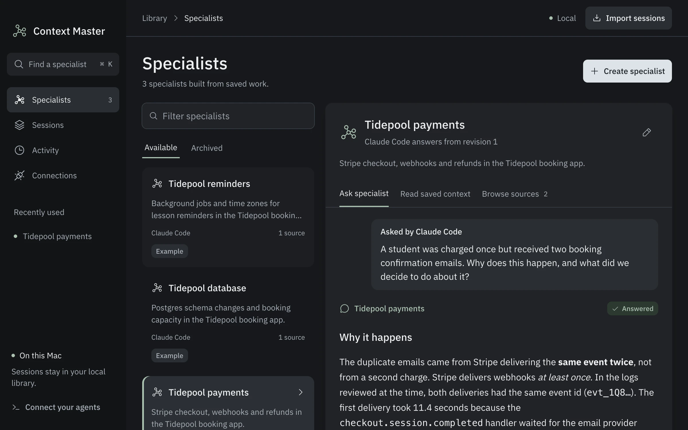

# Context Master

Context Master is a Mac app that turns your old Claude Code, Codex, OpenCode and Cursor chats into specialists that other coding agents can ask questions over MCP (Model Context Protocol, the standard way agents call outside tools).



> Requires an Apple silicon Mac. Answers run through a Claude Code or Codex CLI you are already logged in to, so they use that subscription. The app is signed locally but not notarized by Apple, so a downloaded DMG needs one extra approval (see below).

## Install

```bash
curl -fsSL https://github.com/Imhaohao/context-master/releases/latest/download/install.sh | sh
```

The script downloads the latest release, puts `Context Master.app` in `/Applications` (or `~/Applications`) and opens it. Prefer a DMG? Download `Context-Master-arm64.dmg` from [Releases](https://github.com/Imhaohao/context-master/releases/latest), drag the app to Applications, open it once, then choose **Open Anyway** in System Settings > Privacy & Security.

## Worked example

1. Open the app and choose **Try the example library**. It adds three specialists built from four demo chats about a made-up surf-school booking app. With your own history, choose **Import sessions**, tick the chats worth keeping, and create a specialist from them.
2. Open **Connections** and copy the Claude Code command. For the default install it is:

   ```bash
   claude mcp add --scope user context-master -e ELECTRON_RUN_AS_NODE=1 -- '/Applications/Context Master.app/Contents/MacOS/Context Master' '/Applications/Context Master.app/Contents/Resources/agent/mcp.cjs'
   ```

   Codex gets the same thing as `codex mcp add context-master ...`.
3. In any project, ask your agent something one of those old chats already solved:

   ```bash
   claude -p "A student was charged once but got two booking confirmation emails. Ask the right context-master specialist why, and what we decided to do."
   ```

   Claude Code calls `search_specialists`, picks **Tidepool payments**, and calls `ask_specialist`. The specialist answers from the saved chats with numbered sources: Stripe retried a webhook because the handler waited 11.4 seconds for the email provider, and the recorded fix is to dedupe on the Stripe event id, reply within a second or two, and send email from a job queue. The question then shows up in the app as "Asked by Claude Code" with the sources it used.

## What another agent can call

| Tool | What it does |
| --- | --- |
| `search_specialists` | Ranks specialists by how well their chats match a question |
| `ask_specialist` | Asks one specialist; it answers through your CLI login with cited sources |
| `get_specialist_context` | Returns the specialist's brief and up to six source excerpts with no model call |
| `get_consultation` | Reads back an earlier answer and its sources |

## What stays on your Mac

| Thing | Where it goes |
| --- | --- |
| Imported chats and specialists | `~/Library/Application Support/Context Master/library.db`, readable only by you |
| Your original chat files | Read only; never changed, resumed or deleted |
| An `ask_specialist` call | Sends the brief, the question and up to six excerpts to the CLI's model provider |
| A `get_specialist_context` call | Nothing leaves the Mac |

Common credential patterns (OpenAI, Anthropic, GitHub and AWS keys, private keys, bearer tokens, `password=`-style assignments) are redacted on import, but check a chat before turning it into a specialist.

## Where chats are found

| Agent | Source |
| --- | --- |
| Claude Code | `~/.claude/projects` session files |
| Codex | `~/.codex/sessions` and its thread titles |
| OpenCode | Its local session database and JSON exports |
| Cursor | Composer chats in its local state database, or JSON exports |
| Anything else | JSON or JSONL with user/assistant roles, or a role-labelled text transcript |

Specialists answer through Claude Code, Codex or OpenCode. Each CLI must report a subscription login and support turning off every tool; the Connections screen shows which ones pass. Codex is blocked when the installed version lists features the safety check does not recognise.

## Build from source

Node 22.13 or later.

```bash
npm ci
npm run desktop:dev
```

```bash
npm run check        # typecheck, lint (cyclomatic complexity 15), unit tests
npm run test:e2e     # browser flows and accessibility checks
npm run desktop:dist # Apple silicon DMG and zip in release/
```

`npm run cli -- --help` lists the same operations as a command-line tool.
